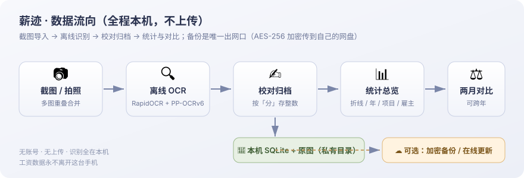

# 薪迹 · 本地工资条记录与对比

拍/截图导入工资条 → 离线 OCR 自动填表 → 按月归档 → 年度总览 → 两月逐项对比。
**数据只存在手机里，不上传、不需要账号。**
（联网只有两处，都是可选：① 检查更新 / 应用内更新——读版本号、下载 APK；② 云盘备份——需你主动填 WebDAV 服务器并点上传，备份是 AES-256 加密后传到你自己的网盘。不开则完全离线。）



---

## 一、已实现的功能

| 模块 | 实现情况 |
|---|---|
| 多图导入 | 相册多选、拍照，支持一次导入多张 |
| **多图重叠合并** | 按行序列检测相邻图的重叠区，自动去重；无重叠会告警；去重项可展开撤回 |
| 离线 OCR | RapidOCR4j-Android + PP-OCRv6_small + OpenCV 预处理，ONNX Runtime 本地推理 |
| 识别预填 | 项目名 / 金额 / 合计行 / 系数行自动分拣，口径不对会标黄 |
| 合计校验 | 明细加总 ≠ 应发、应发−代扣 ≠ 实发 时提示，但不阻止保存 |
| 手动录入 | 不用图片也能记 |
| 动态明细项 | 收入 / 扣款两组，支持「金额型」和「系数型」（绩效系数） |
| 同月多笔 | 补发、绩效二次发放可分开记，统计时自动求和 |
| 奖金记录 | 年终奖、项目奖金独立类型，简化表单，不进月度对比 |
| 列表 / 详情 / 编辑 / 删除 | 每月卡片、多笔展开、原图可看 |
| 年度总览 | 工资 / 奖金 / 总收入三口径，年度榜，月度折线（按年 / 跨年合并可切） |
| 选年选月 | 首页年份、统计范围、图表年份、对比月份统一用底部弹窗：格子铺开一眼看全，各格带实发金额，没数据的置灰 |
| 两月对比 | **可跨年选择**；逐项差额 + 变化率 + 新增/消失的真实金额；绩效系数、信息项（部门/出勤）也参与对比 |
| 发薪模板 | 按雇主 + **适用类型**（月度 / 奖金 / 通用）各自生效，年终奖不再被月度字段污染 |
| 备份恢复 | 单一「导出备份」入口，弹窗选明文 `.zip`（含 CSV）/ 加密 `.xbk`（AES-256），**默认存到手机「下载」目录**（文件管理器可见可删）；设置里有「本地备份管理」清理旧备份；一键恢复；偏好设置随备份一起还原 |
| 云盘备份 | 可选功能，WebDAV（坚果云 / 群晖 / Nextcloud）上传/下载加密备份；密码可看明文、本机记住；**每月指定日自动备份**，默认关闭 |
| 应用锁 | 指纹/面容优先 + PIN 兜底 + 提示语找回；锁定时**整个 App 任何页面**（含设置页）都要先验证；切后台重新锁定时长可配（立即～5 分钟）；可选**应用内悬浮锁定按钮**（渐变透明、可拖动、吸附两侧，大小 40–68dp 与贴边三档【贴边/微贴/不贴】集中在一个弹框配置，一点即锁） |
| 隐私保护 | 切后台由**原生遮罩层**盖住（`PrivacyMaskView`，在 `onPause` 同步挂到 FlutterView 之上）：深色磨砂底 + 中央应用图标 + 闭眼徽标，无文字。按 Home 键或返回键退出都能稳定遮住，最近任务里看到的是这个遮罩而不是工资明细。回前台自动移除，开关可关 + 首页顶栏一键金额打码（¥****）。不用 `FLAG_SECURE`（它会让最近任务变空白卡片），因此系统级防截屏/录屏能力随之取消 |
| 在线更新 | 应用内后台下载、断点续传，常驻进度条（百分比/速度/剩余时间），不打断使用；**gh-proxy.com / ghfast.top / ghproxy.net / 官方直链四线路**，可手动切换、失败自动换线；**SHA-256 校验**防截断包；后台点通知可直接拉起安装；安装包自动清理，不留旧版本 |
| 主题外观 | 5 套配色 + 浅色/深色/跟随系统，涨红跌绿保持不变 |

---

## 怎么变成能装到手机上的 App

**推荐：GitHub 云端打包，电脑不用装任何开发环境。**

```bash
# 1. 在 GitHub 建一个 Private 空仓库，名字随便（下面以 xinji 为例）
# 2. 推到仓库
git remote add origin https://github.com/你的用户名/xinji.git
git push -u origin main
# 3. 打开 https://github.com/你的用户名/xinji/actions → 左边「打包 APK」→ Run workflow
# 4. 等 10 分钟，手机浏览器打开下面这个固定链接直接下载安装
#    https://github.com/你的用户名/xinji/releases/latest/download/xinji.apk
```

完整步骤、报错对照表、签名与 Secrets 说明见 **[GITHUB打包指南.md](GITHUB打包指南.md)**。

也可以在自己电脑上编译（要装 JDK 17 + Flutter + Android SDK，约 10GB），步骤见 [打包指南.md](打包指南.md)——**不是必需**，除非你想离线改代码。

> 更新版本时**直接覆盖安装，不要卸载**。卸载会连本地数据库和原图一起删掉。

---

## 二、目录结构

```
xinji/
├── pubspec.yaml                      依赖清单
├── lib/
│   ├── main.dart                     入口、全局 Provider、后台超时上锁
│   ├── core/
│   │   ├── money.dart                ★ 金额解析与格式化（全部按「分」存整数）
│   │   └── app_update.dart           检查更新、多线路下载编排、线路偏好
│   ├── data/
│   │   ├── models.dart               数据模型（PayRecord / PayItem / PayImage / ItemTemplate）
│   │   ├── db.dart                   SQLite 建表、迁移、预置模板
│   │   ├── record_dao.dart           记录读写
│   │   └── template_dao.dart         模板读写
│   ├── ocr/
│   │   ├── ocr_models.dart           三层中间结构：RawLine → VisualRow → ParsedRow
│   │   ├── line_builder.dart         按 y 坐标把碎片聚成「视觉行」
│   │   ├── field_parser.dart         ★ 从行里解析项目名/金额/合计/系数
│   │   ├── merge_engine.dart         ★★ 多图重叠合并（本项目最核心算法）
│   │   └── ocr_service.dart          OCR 门面 + 长截图压缩
│   ├── stats/
│   │   ├── salary_stats.dart         月/年聚合、跨年期间、对比计算
│   │   └── range_stats.dart          任意范围汇总（带懒缓存）
│   ├── security/
│   │   └── lock_service.dart         PIN 哈希、生物识别、提示语找回
│   ├── backup/
│   │   ├── backup_service.dart       ZIP / AES 加密备份、导出到 Download、本地备份管理
│   │   ├── cloud_backup.dart         WebDAV 云盘备份（可选，默认关闭）
│   │   └── cloud_auto_backup.dart    每月指定日自动备份（打开 App 时补做）
│   ├── state/
│   │   └── app_state.dart            全局状态、OCR 流程编排
│   └── ui/
│       ├── theme.dart                主题：5 套配色 + 深浅模式 + 语义色（涨红跌绿）
│       ├── home_page.dart            首页：年份 + 月份卡片
│       ├── import_page.dart          导入入口
│       ├── review_page.dart          ★ 校对 / 新建 / 编辑（同一表单三用）
│       ├── detail_page.dart          单条详情
│       ├── yearly_page.dart          年度总览
│       ├── compare_page.dart         两月对比
│       ├── year_picker.dart          年份选择弹窗（首页 / 统计共用）
│       ├── update_dialog.dart        发现新版本弹窗（含下载线路选择）
│       ├── settings_page.dart        设置 + 项目模板管理
│       ├── lock_page.dart            解锁 / 设置锁 / 找回 PIN
│       ├── backup_manager_page.dart  本地备份管理（列出/删除私有目录旧备份）
│       └── widgets/
│           ├── image_viewer.dart     原图查看
│           ├── info_hint.dart        ⓘ 说明角标（收敛长解释）
│           ├── app_tip.dart          统一 SnackBar 轻提示（带关闭按钮）
│           └── floating_lock_button.dart  应用内可拖动悬浮锁定按钮
├── android/                          Android 工程配置（云构建用）
│   ├── app/build.gradle.kts          minSdk 29、包名、签名、关混淆
│   ├── app/src/main/AndroidManifest.xml  应用名、权限、透明安装入口
│   ├── app/src/main/kotlin/.../MainActivity.kt  FlutterFragmentActivity（指纹必需）
│   ├── app/src/main/kotlin/.../UpdateDownloadService.kt  前台下载 + 多线路 + SHA-256 校验
│   ├── app/src/main/kotlin/.../UpdateCache.kt  安装包/残留清理
│   ├── app/src/main/kotlin/.../InstallLauncherActivity.kt  后台点通知拉起安装
│   ├── app/keystore/xinji.jks        签名文件（改动会导致不能覆盖安装）
│   └── key.properties                签名密码
├── .github/workflows/build-apk.yml   ★ GitHub Actions 自动打包
├── analysis_options.yaml             静态检查规则
├── test/core_logic_test.dart         核心算法测试（合并 / 金额 / 系数）
├── GITHUB打包指南.md                 ★ 手机拿到 APK 的最快路径（推荐）
└── 打包指南.md                       本地装环境自己编译（备选）
```

---

## 三、几个关键设计（为什么这么写）

### 1. 金额一律按「分」存整数
`0.1 + 0.2 != 0.3`。工资条的核心功能是「明细加总 == 合计」的校验，
如果用 double，每次校验都会差 1 分钱，报警会响个不停。
所以 `amountCents` 是 int（12345.67 元 → 1234567 分），只在显示和导出时格式化。

### 2. 多图合并靠「行序列重叠」，不靠项目名去重
你的真实场景是：明细太长 → 分屏截图 → 相邻两张有重叠区。

如果按项目名去重，两笔同名的奖金会被误删。所以做法是：

```
图A 的末尾 k 行  ==  图B 的头部 k 行   →  判定重叠，去掉这 k 行
```

从最大的 k 开始往下试，第一个匹配上的就是最长重叠。
匹配不上时再分两种情况：弱重叠（首行出现过）→ 提示交界处可能被切断；
完全不重叠 → 提示中间可能漏截。**绝不静默吞数据。**

另外三处兜底：
- 合计行单独抽出来，不参与重叠匹配（否则每张图底部的「合计」会干扰比对）
- 拼接后相邻的同名同额行自动去重，但记入「已去除项」，可一键撤回
- 最后用「明细加总 vs 工资条合计」做终检，这是发现漏行最可靠的信号

**水印清理也踩过坑。** 企业工资条上铺满浅灰的「安心工资条 1279」，
判据是「同一串文字重复出现多次就是水印」。可年终奖条把同一个数印了三遍
（年终奖金 / 应发奖金合计 / 本次应发奖金 都是 25299），按这个判据会被整片
当水印删掉，最后整张纸只剩「个税」一项。现在的规则是：

- 纯数字要重复 **5 次以上**才算水印；重复 3 次以上时，还要看右边界是不是
  散得很开（水印是斜着铺的，真实金额是右对齐成一列的）；
- 名字整格被判成水印、但这一行有金额时，把名字借回来 —— 金额在，名字就得在；
- 顶部那个两三倍大的展示数字（`height > 正文中位数 × 1.8` 且不在金额列上）
  直接排除，否则会凭空多出一笔收入。

### 3. 项目名不写死在代码里
明细项全部走 `pay_item` 表 + `item_template` 模板。
换公司、公司改项目名（「岗位津贴」→「岗位工资」）都不用改代码，
在设置里加个别名就能让对比重新对齐。

**两个「模板」不是一回事**，容易混：

| | 项目模板（`item_template`） | 工资条模板（`salary_template`） |
|---|---|---|
| 是什么 | 名字词典 | 这家公司工资条长什么样 |
| 管什么 | 某一项算收入还是扣款、有哪些别名、是金额还是系数 | 有哪些字段、按什么顺序排、月度还是奖金 |
| 影响 | OCR 归类、跨月对齐 | 录入时的预填空行、明细排序 |
| 范围 | 全局共用，不分雇主 | 按雇主分开，每种适用类型各一套生效 |

奖金条识别不到「应发奖金」这类问题，多半是项目模板里没有对应项目/别名
（去项目模板加一个，或在那行别名里补上），也可能被当成了合计行 ——
新版会把"带金额但没进明细的行"列在合并摘要里，点开能直接加进来。

### 4. 主表只留通用字段
`periodYear / periodMonth / recordType / gross / deduction / net` 是任何公司都有的。
薪级、基薪、备注这些塞进 `extra`（JSON），不占表结构。

### 5. 奖金和工资分开口径
奖金塞进月度柱状图会让某个月突然高十倍，图就没法看了。
所以：柱状图只画月度工资，奖金单独一块；月度对比也只比月度工资。

### 6. 更新下载：多线路 + 校验 + 自动清理
GitHub Releases 在国内下载慢、偶尔失败，所以做了三层处理：

- **四线路**：默认走 `gh-proxy.com`，失败依次换 `ghfast.top` → `ghproxy.net` → 官方直链。
  在更新弹窗里可以手动选，选过的会记住；官方直链永远兜底。
  注意第三方代理能看到你的下载请求 IP，介意就选官方直链。
- **SHA-256 校验**：CI 发版时生成 `xinji.apk.sha256` 随包上传，App 下载完比对哈希，
  不匹配就换线路重下 —— 防止代理返回错误页、CDN 截断的半截包被当成 APK 装上去。
- **通知栏安装**：下载完点通知就能装。原来用 `PendingIntent.getService` + 后台
  `startActivity`，Android 10+ 会拦掉后台启动，表现为"点了没反应"。现在改成拉起一个
  透明的 `InstallLauncherActivity`，由前台 Activity 调系统安装器。
- **自动清理**：新版启动后只保留当前版本的 APK，其它版本的 `.apk` 和 `.part` 全删；
  没下完的 `.part` 留一天还能续传，过期清掉。设置页也有「清理更新缓存」手动一键清。

### 7. 统计性能：一次遍历 + 懒缓存
数据量小时无所谓，但统计页一次 build 会反复读同一批聚合值：

- `StatsBuilder.buildYear` 原来每月 `where` 全表扫一遍（12 次），首页年份弹窗又按年调用
  N 次；现在一次遍历按月份分桶，`O(记录数 + 12)`。
- `RangeSummary` 的 `byYear` / `byMonthOfYear` / `incomeByItem` 等 getter 加了懒缓存，
  同一份数据在一个页面里只算一次。
- `normalizeName` / 模板匹配的高频正则提成静态常量，归一化结果带上限缓存 —— 识别时按
  「行 × 模板 × 别名」放大的调用，省下的开销很可观。

---

## 四、已知限制（说清楚，别踩坑）

1. **OCR 不可能 100% 准**。绩效系数（1.20 这种小数）、带括号的负数、深色背景图最容易出错。
   所以流程设计成「识别 → 预填 → 你扫一眼改 → 保存」，不是全自动。
2. **首次使用识别率最低**。公司项目名和预置模板对不上时，需要你手动改一次名称；
   改完它会记住（你也可以去模板里加别名）。
3. **卸载 App 会连数据一起删**。本地存储的必然代价，请定期导出备份。
4. **忘记 PIN 只能靠提示语**。提示语也忘了，就只剩「清除数据重装」。
5. **APK 体积约 96MB**。PP-OCRv6 模型（25MB）、单套 arm64 的 ONNX Runtime + OpenCV native 库都在包里，这是完全离线的代价。只支持 64 位手机（现在的新机都是）。
6. **检查更新走应用内下载**。仓库已公开，联网只用于读版本号和下载 APK，不带走任何工资数据。默认走 gh-proxy 加速线路（第三方能看到下载 IP，介意就在更新弹窗切官方直链）；下载完做 SHA-256 校验，确保拿到的是完整安装包。
7. **后台隐藏：毛玻璃遮罩 + 系统级兜底，开关可关**。
   目标效果是「最近任务里看到一片模糊 + 应用图标 + 闭眼徽标」，读不出任何数字。
   实现分两层：
   - **可见层（Flutter `_PrivacyMask`）**：`BackdropFilter` 实时模糊（sigma 20）+
     28% 暗层 + 96dp 圆形底盘 + 应用图标 + 右下角 `visibility_off` 徽标。
     触发点是 `AppLifecycleState.inactive` —— 那一刻窗口仍可见、engine 仍在渲染，
     所以这一帧来得及画上；拖到 `paused` 就晚了（engine 已停帧）。
     回到前台立刻撤掉，不会出现「回前台才画再撤」的闪。
   - **兜底层（原生）**：
     - Android 12 及以下：`onPause` 给窗口 `addFlags(FLAG_SECURE)`、`onResume` `clearFlags`。
       只在后台加，前台截屏、录屏、投屏正常。
     - Android 13+：`setRecentsScreenshotEnabled(true)` **明确允许**系统生成快照，
       并把最近任务卡片设成深色底 + 应用图标 + 「薪迹」（`TaskDescription`）。
       这里必须是 `true`：设成 `false` 会让系统干脆不拍，最近任务只剩一张空白白卡，
       模糊画面永远不可能出现。13+ 也不再叠加 `FLAG_SECURE`，避免和这个旋钮打架。

   应用图标的 PNG 由原生 `appIcon` 通道提供，启动时 `preloadAppIcon()` 预取缓存 ——
   遮罩在切后台瞬间绘制，那时不能现读 `PackageManager`。

   说明：曾系统性试过四种原生遮罩（临时 `addView` / 常驻 View 切 alpha /
   `SurfaceView` + `lockCanvas` 同步提交 / `SurfaceControl` 事务切 layer alpha），
   前三者抢不过系统抓图，第四者会在 surface 重建时 layer alpha 复位为 1，
   把不透明遮罩糊在前台界面上（App 没法用），均已移除。
   悬浮锁定按钮只是**应用内**浮层（退出 App 即消失），不需要系统悬浮窗权限；
   渐变透明、无实线边框，大小 40–68dp 与贴边三档（贴边/微贴/不贴）在设置里的同一个弹框配置。
8. **v2.0.0 起 minSdk 升到 29**。Android 10 及以下装不了；从旧版覆盖安装如失败，先导出备份再卸载重装。
9. **定时云盘备份不是真后台任务**。到了你设定的日期后，需要打开一次 App 才会补做（后台常驻要额外引依赖、耗电、还容易被系统杀）。当月已经成功备份过就不会重复上传。

---

## 五、下一步可以加的（V2 方向）

- 导出 Excel / PDF（当前备份里的 CSV 已能直接喂给 Excel）
- 分类占比、绩效系数走势、税负率曲线
- 发薪日提醒
- iOS 适配（代码结构已按跨端写，主要补 iOS 权限声明和打包配置）
